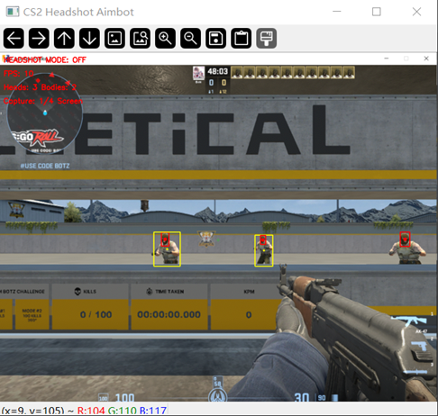
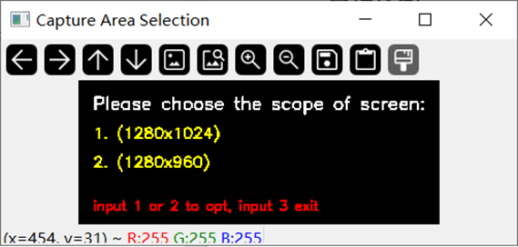
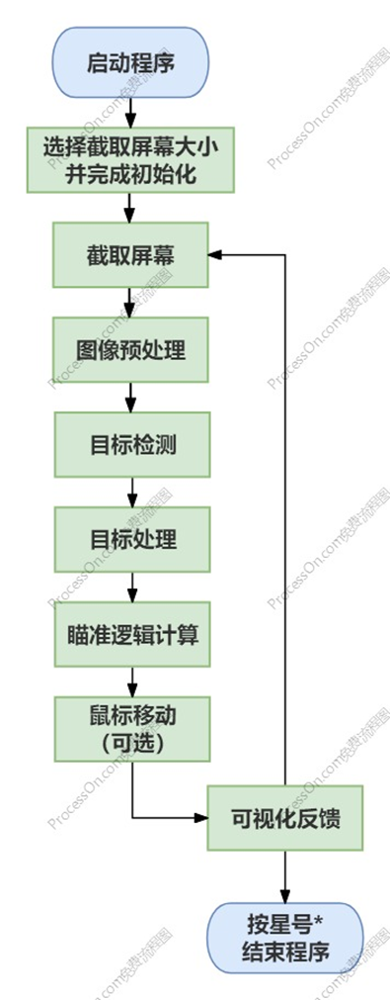
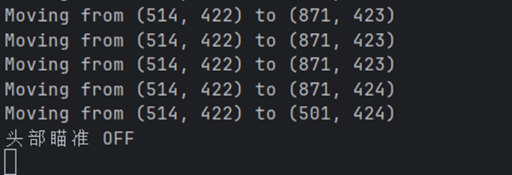
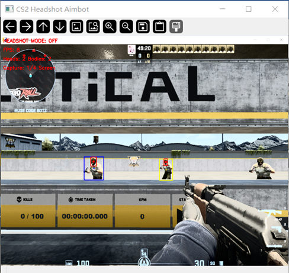

<div align="center">

# CS2 Headshot Aimbot

**基于 YOLOv8 + OpenCV 的《Counter-Strike 2》头部检测与辅助瞄准系统**

一个用计算机视觉实现实时目标检测的课程设计项目：循环截取屏幕画面 → 图像预处理 → YOLOv8 推理识别 CT / T 阵营的身体与头部 → 坐标换算 → 移动准星，并提供实时可视化反馈。

[](https://www.python.org/)
[](https://pytorch.org/)
[](https://www.ultralytics.com/)
[](https://opencv.org/)
[](https://developer.nvidia.com/cuda-zone)
[](https://www.microsoft.com/windows)
[](./LICENSE)
[](https://github.com/your-name/CS2-Headshot-Aimbot/stargazers)
[](https://github.com/your-name/CS2-Headshot-Aimbot/network/members)
[](https://github.com/your-name/CS2-Headshot-Aimbot/issues)

简体中文

</div>

---

## 📸 效果展示 | Demo

### 实时检测效果

实时检测 3 个敌方目标（2 身体 + 1 头部），左上角叠加 FPS、目标数量统计与截屏模式：



> 黄色框 = T 阵营身体，蓝色框 = CT 阵营身体，绿色框 = CT 阵营头部，红色框 = T 阵营头部，框内中心的小点为该目标的中心点。

### 启动时的截取区域选择

启动后弹出选择窗口，`1` / `2` 切换截屏尺寸，`3` 退出：



### 程序流程



---

## ✨ 功能特性 | Features

- 🎯 **四类别目标检测** — 同时识别 CT / T 两个阵营的身体与头部
- ⚡ **GPU 自动加速** — 运行时动态探测 `torch.cuda.is_available()`，有独显走 CUDA，无独显自动回退 CPU
- 🖼️ **实时屏幕捕获** — `ImageGrab` 定向抓取指定区域，支持启动时选择 1/4 屏或 1/2 屏
- 🎨 **可视化反馈窗口** — 实时绘制检测框、中心点，并叠加 FPS、头部/身体计数、瞄准开关状态
- ⌨️ **全局热键控制** — 小键盘 `0` 一键开关辅助瞄准，小键盘 `*` 安全退出程序，不与游戏按键冲突
- 🧹 **降噪预处理** — PIL→BGR 格式转换 + 高斯模糊，有效抑制画面噪点
- 🔧 **完全可调** — 置信度、IoU、输入尺寸、边框配色、捕获区域均为可配置项

---

## 🛠 技术栈 | Tech Stack

| 模块 | 选型 | 说明 |
| :--- | :--- | :--- |
| 目标检测 | **YOLOv8n**（Ultralytics） | 预训练权重 + 自定义数据集微调，输出边界框与类别 |
| 深度学习框架 | **PyTorch 2.5.1** | 训练与推理后端 |
| 图像处理 | **OpenCV 4.x** | 高斯模糊降噪、矩形框绘制、窗口交互与文字叠加 |
| 屏幕捕获 | **Pillow `ImageGrab`** | 屏幕区域抓取 |
| 系统控制 | **PyWin32** | `GetSystemMetrics` 获取分辨率、`GetAsyncKeyState` 监听全局热键 |
| 鼠标控制 | **pynput** | `Controller.mouse.position` 实现准星平滑移动 |
| 环境管理 | **conda 25.3.1** | 隔离 CUDA / PyTorch 依赖 |
| 语言 | **Python 3.9** | — |

---

## 📋 环境要求 | Requirements

### 软件环境

```
OS          Windows 10 / 11
conda       25.3.1
python      3.9
cuda        12.9
pytorch     2.5.1
ultralytics 8.3.147
```

### 硬件环境（参考配置）

| 硬件 | 型号 |
| :--- | :--- |
| CPU | Intel® Core™ i9-9980HK |
| GPU | NVIDIA GeForce GTX 1650 |

> GTX 1650 属于入门级显卡，运行 YOLOv8n 无压力；若换用 `yolov8m` / `yolov8l` 等更大模型，建议显存 ≥ 8GB 并适当下调 `imgsz`。

---

## 🚀 快速开始 | Quick Start

### 1. 克隆仓库

```bash
git clone https://github.com/your-name/CS2-Headshot-Aimbot.git
cd CS2-Headshot-Aimbot
```

### 2. 创建 conda 环境

```bash
conda create -n cs2-aimbot python=3.9 -y
conda activate cs2-aimbot
```

### 3. 安装 PyTorch（按自己的 CUDA 版本选一条）

```bash
# CUDA 12.1
pip install torch torchvision --index-url https://download.pytorch.org/whl/cu121

# CUDA 12.4
pip install torch torchvision --index-url https://download.pytorch.org/whl/cu124
```

### 4. 安装其余依赖

```bash
pip install -r requirements.txt
```

<details>
<summary>requirements.txt 内容</summary>

```txt
ultralytics==8.3.147
opencv-python>=4.8.0
Pillow>=10.0.0
numpy>=1.24.0
pywin32>=306
pynput>=1.7.6
```

</details>

### 5. 放置模型权重

把训练得到的权重重命名放到指定路径：

```
model/weights/CS2-AimBot.pt
```
> 可使用附带的CS2-AimBot.pt作为检测权重。
> 也可通过 [Roboflow Universe](https://universe.roboflow.com/my-workspace-aqzti/test-un5ld/dataset/4) 获取数据集后自行训练。

### 6. 运行

```bash
python main.py
```

---

## 🎮 操作说明 | Controls

| 按键 | 功能 | 说明 |
| :---: | :--- | :--- |
| `小键盘 0` | 开关辅助瞄准 | 切换 `aim_enabled` 状态，开关状态实时显示在反馈窗口左上角 |
| `小键盘 *` | 结束程序 | 通过 `running` 标志安全退出主循环 |
| `1` | 选择 1280×1024 捕获区 | 约 1/4 屏，反馈窗口按 0.5 倍缩放显示 |
| `2` | 选择 1280×960 捕获区 | 约 1/2 屏，反馈窗口按 0.6 倍缩放显示 |
| `3` | 退出选择窗口 | 启动阶段直接结束程序 |

> 两个热键都选在**小键盘**区域，是为了彻底避开 CS2 的默认键位绑定。

### 检测类别与配色

| 类别 | 含义 | 边框颜色 | RGB |
| :--- | :--- | :--- | :--- |
| `CT` | 警察阵营身体 | 🔵 蓝色 | `(255, 0, 0)` |
| `T` | 恐怖分子阵营身体 | 🟡 黄色 | `(0, 255, 255)` |
| `CT_HEAD` | 警察阵营头部 | 🟢 绿色 | `(0, 255, 0)` |
| `T_HEAD` | 恐怖分子阵营头部 | 🔴 红色 | `(0, 0, 255)` |

配色定义见 [`docs/images/code-class-colors.png`](./docs/images/code-class-colors.png)。

---

## ⚙️ 参数配置 | Configuration

核心参数集中在 `__init__` 中，按需修改即可：

| 参数 | 默认值 | 说明 |
| :--- | :--- | :--- |
| `model_path` | `model/weights/CS2-AimBot.pt` | 模型权重路径 |
| `conf` | `0.4` | 置信度阈值，调高可减少误检 |
| `iou` | `0.05` | NMS 的 IoU 阈值，调高可抑制重复框 |
| `imgsz` | `640` | 推理输入尺寸，越小越快 |
| `device` | 自动 | `torch.cuda.is_available()` 为真则用 `0`，否则用 `cpu` |
| `verbose` | `False` | 静默模式，关闭 ultralytics 的逐帧日志 |
| `capture_width` | `1280` | 捕获区宽度 |
| `capture_height` | `1024` / `960` | 捕获区高度，随启动选择而变 |
| `aim_enabled` | `False` | 辅助瞄准开关初值 |
| `running` | `True` | 主循环运行标志 |

---

## 🗂 项目结构 | Project Structure

当前实现为**单文件程序**（约 230 行），结构如下：

```
CS2-Headshot-Aimbot/
├── main.py                      # 主程序：初始化 / 捕获 / 推理 / 瞄准 / 可视化
├── requirements.txt
├── LICENSE
├── README.md
├── model/
│   └── weights/
│       └── CS2-AimBot.pt       # 训练产出的权重（需自行放置）
├── tools/
│   └── train.py                 # 模型训练脚本
└── docs/
    └── images/                  # README 引用配图
```

### 主程序执行流程

| 阶段 | 做了什么 | 代码 |
| :--- | :--- | :--- |
| 初始化 | 读取分辨率、定义配色、加载模型、设置捕获区 | [`code-load-model.png`](./docs/images/code-load-model.png) |
| 屏幕捕获 | `ImageGrab.grab` 循环抓取指定区域 | [`code-screen-grab-loop.png`](./docs/images/code-screen-grab-loop.png) |
| 图像预处理 | PIL→BGR 转换 + 高斯模糊降噪 | [`code-gaussian-blur.png`](./docs/images/code-gaussian-blur.png) |
| 目标检测 | `YOLO.predict()` 静默推理 | [`code-yolo-predict.png`](./docs/images/code-yolo-predict.png) |
| 目标处理 | 解析结果、绘制边框、计算中心点 | [`code-detection-results.png`](./docs/images/code-detection-results.png) |
| 瞄准计算 | 找最近头部 → 相对坐标转绝对坐标 | [`code-nearest-head.png`](./docs/images/code-nearest-head.png) |
| 鼠标控制 | `Controller.mouse.position` 平滑移动 | [`code-mouse-move.png`](./docs/images/code-mouse-move.png) |
| 可视化 | 缩放显示 + FPS/计数叠加 | [`code-visualization.png`](./docs/images/code-visualization.png) |

---

## 🧠 模型训练 | Model Training

### 数据集

数据集来源：<https://universe.roboflow.com/my-workspace-aqzti/test-un5ld/dataset/4>

### 训练配置

基于预训练权重 `yolov8n.pt` 微调，关键超参如下：

```python
model = YOLO('yolov8n.pt')          # 预训练权重

model.train(
    data       = 'data.yaml',
    epochs     = 150,                # 总计约 150 轮
    lr0        = 0.005,              # 初始学习率
    lrf        = 0.005,              # 最终学习率
    amp        = True,               # 混合精度训练
    cos_lr     = True,               # 余弦退火
    warmup_epochs = 3,               # 学习率预热
    dropout    = 0.2,
    patience   = 30,                 # 早停机制
)
```

训练完成后将最佳权重重命名为 `CS2-AimBot.pt`，放入 `model/weights/`。

---

## ⚠️ 已知问题 | Known Issues

### 鼠标控制功能在 CS2 中不生效

这是本项目目前**最主要也最诚实**的一个结论：目标检测完全可用，但**鼠标移动在 CS2 客户端内读不到**。

控制台持续输出同一组坐标，起点纹丝不动：



```
Moving from (514, 422) to (871, 423)
Moving from (514, 422) to (871, 423)
...
```

**分析：**

1. **坐标读数始终不变** — 说明 `pynput` 发出的移动事件游戏根本没收到，或被 CS2 的 **VAC 反作弊**在输入层直接过滤掉了。
2. **第一人称视角是极坐标而非直角坐标** — FPS 的视野是一个"底面为长方形的三角锥"，具备近大远小的透视特性；准星的移动本质是视角向量在极坐标下转动，游戏内部会读取**原始输入设备（Raw Input）**数据，而非模拟的鼠标事件。模拟事件被拦在门外是很自然的。
3. **可行的技术路线是 DMA 注入** — 绕过输入层、直接读写内存。但本项目**没有采用**，原因有二：一是该技术复杂度超出课程设计范围，二是**大概率触犯游戏用户协议与反作弊规则**，与本项目"研究计算机视觉检测技术"的学习初衷背道而驰。

> 结论：本项目在课程设计范围内实现了**完整的实时目标检测与可视化反馈**，鼠标控制环节止步于理论验证。使用 `pynput` 在桌面应用、演示程序中移动鼠标是完全正常的，问题只出在带反作弊的竞技游戏中。

### 预处理取舍：为什么弃用直方图均衡化

最初在预处理中加入了直方图均衡化以增强阴影区域对比度，实测后发现**弊大于利**：

- ✅ 阴影下目标的识别率确实提升
- ❌ 正常光照下的目标识别率与准确率反而下降
- ❌ 可视化帧率平均下降 3~4 FPS，能明显感到卡顿
- ❌ 均衡化后的画面观感很差

下图中三个人物全部为 T 阵营模型，**右图（开启均衡化）出现了明显误检**：



最终方案只保留 `GaussianBlur` 高斯模糊降噪。

---

## 🗺 后续计划 | Roadmap

- [x] YOLOv8 四类别目标检测
- [x] 实时屏幕捕获与可视化反馈
- [x] 全局热键控制与双捕获模式
- [ ] **模型升级** — 尝试 `yolov8m` / `yolov8l`，或在现有权重上继续训练提升精度
- [ ] **性能优化** — 引入多线程/异步流水线，拆分截屏、推理、绘制三个阶段以提高帧率
- [ ] **健壮性** — 补充异常处理（模型加载失败、窗口被遮挡、分辨率变化等）
- [ ] **模块化重构** — 拆分为 `capture` / `preprocess` / `detector` / `aim` / `ui` 五个子模块
- [ ] **配置外置** — 把超参迁移到 `config.yaml`，方便调参

---

## 📄 开源协议 | License

本项目基于 [MIT License](./LICENSE) 开源。

---

## 🙏 致谢 | Acknowledgements

- [Ultralytics YOLO](https://github.com/ultralytics/ultralytics) — 目标检测框架
- [Roboflow Universe](https://universe.roboflow.com/) — 数据集托管与标注
- 参考资料：
  - 懒大王爱吃狼. *Pytorch + CUDA 配置教程（Windows 版）*. CSDN 博客, 2024. <https://blog.csdn.net/m0_65482549/article/details/141195825>
  - AI时代小作坊. *2025 最强 YOLOv8 实战模型训练*. Bilibili, 2022. <https://www.bilibili.com/video/BV1XUV9zxECY>

---

## ⚖️ 免责声明 | Disclaimer

本项目仅供计算机视觉、深度学习的学习与研究使用。严禁用于任何在线游戏作弊行为。

请注意：

1. 本仓库**不提供、也不鼓励**用于任何破坏游戏公平性的实际作弊行为。
2. 在任何在线竞技游戏中使用辅助瞄准类工具，**均可能违反该游戏的用户协议并导致账号封禁**，由此产生的一切后果由使用者自行承担。
3. 请勿将本项目用于商业用途或任何违法用途。

**作者已完成目标检测部分的技术验证，并在能力边界内选择了停止。继续前进需要的技术手段已超出学习目的的合理范围。**
